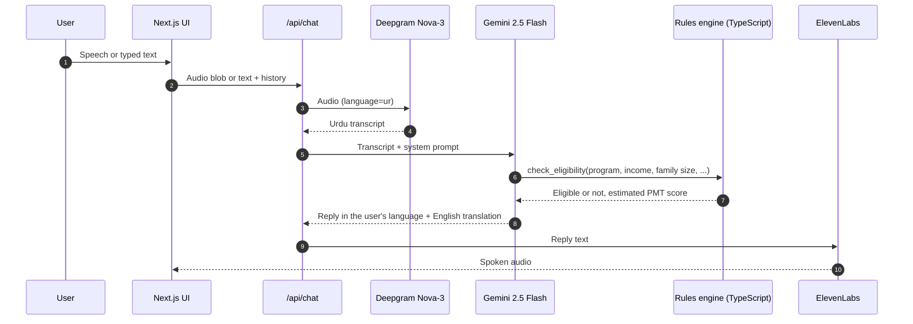

# BISP Benefits Navigator

> A voice-first assistant that pre-screens Pakistani citizens for Benazir Income Support Programme (BISP) schemes, because text-heavy portals shut out low-literacy users. Gemini only extracts the answers; a TypeScript rules engine produces the estimate.

**Status:** Hackathon prototype. Top 10 Finalist (College/Undergraduate track), USAII Global AI Hackathon 2026; #9 of 424 teams in the qualifiers (96/100), 66.5/70 in the final round. Solo build.
**Demo:** The hosted Cloud Run app is offline (hosting credits expired). Run it locally with your own API keys (see Quickstart).

---

## How it works



- Gemini is given one tool, `check_eligibility` (`bisp-voice-navigator/lib/agent-tools.ts`). It extracts parameters and calls the tool; the eligibility logic is in `bisp-voice-navigator/lib/bisp-rules-engine.ts`. The system prompt tells the model not to do the maths itself.
- Programmes covered by the rules engine: Benazir Kafaalat, Taleemi Wazaif, Nashonuma, the Undergraduate Scholarship and Bachat.
- When a Gemini, ElevenLabs or Deepgram call fails with a quota error, the API route retries with the next configured key (up to 6 Gemini, 5 ElevenLabs and 5 Deepgram keys).
- Replies for regional-language users come in two parts: the regional language text, then an English translation shown in the UI.
- Requests are limited to 10 per minute per IP, using an in-memory map in the route handler.
- Audio is forwarded to Deepgram from memory and not written to disk.

## Quickstart

Requires Node.js 20 (the Dockerfile uses `node:20-alpine`) and API keys for Gemini, Deepgram and ElevenLabs. The app lives in `bisp-voice-navigator/`.

```bash
git clone https://github.com/HamzaKhanBUIC/BISP-Benefits-Navigator.git
cd BISP-Benefits-Navigator/bisp-voice-navigator
npm install
# create .env.local with the variables below
npm run dev
```

Open http://localhost:3000.

Optional: `node generate-welcome.mjs` regenerates the cached welcome audio (`public/welcome.mp3`) with ElevenLabs. It reads `ELEVENLABS_API_KEY`.

Other scripts: `npm run build`, `npm start`, `npm run lint`.

## Configuration

Set in `.env.local` (not committed). Read in `bisp-voice-navigator/app/api/chat/route.ts`.

| Variable | Required | Description |
| :-- | :-- | :-- |
| `GEMINI_API_KEY` | yes | Gemini API key (model `gemini-2.5-flash`) |
| `GEMINI_API_KEY_2` ... `GEMINI_API_KEY_6` | no | Backup keys, tried when the previous one hits a quota error |
| `DEEPGRAM_API_KEY` | yes for voice | Speech-to-text (`nova-3`) |
| `DEEPGRAM_API_KEY_2` ... `DEEPGRAM_API_KEY_5` | no | Backup keys |
| `ELEVENLABS_API_KEY` | yes for spoken replies | Text-to-speech (`eleven_multilingual_v2`) |
| `ELEVENLABS_API_KEY_2` ... `ELEVENLABS_API_KEY_5` | no | Backup keys |

Keys are read on the server only.

## Deployment

`bisp-voice-navigator/Dockerfile` and `cloudbuild.yaml` build the image and deploy it to Cloud Run (`us-central1`). Set the environment variables above on the service. This is how the original demo was hosted; it is not currently running.

## Limitations

- **The PMT score is an estimate, not BISP's official Proxy Means Test.** The function is named `calculateMockPMT`: it starts from a base score of 45 and adjusts it for income, family size, assets and province, then compares with a cutoff of 32. Treat results as a rough pre-check only.
- **The programme data in `lib/bisp-data.json` (stipend amounts, cutoffs) has no cited source or date.** Do not rely on it for real decisions.
- **Speech input is Urdu only.** Deepgram is called with `language=ur`. The system prompt also lists Pashto, Punjabi, Sindhi, Balochi and Seraiki, but speech in those languages is not transcribed as such. Typed input is accepted.
- **The disclaimer comes from the prompt, not code.** The model is instructed to say "this is only an estimated pre-check. Actual eligibility is determined by BISP staff"; this is not enforced in code.
- **Rate limiting is weak.** It is per server instance, in memory, and keyed on the `x-forwarded-for` header, which a client can set.
- **Conversation history is sent by the client** and passed to Gemini without validation.
- **Tests:** there is no `npm test` script. The only Jest suite (`lib/enterprise-rules/calculation_router.test.ts`) tests `lib/rules-engine/bisp-calculator.ts`, which the app does not use. The engine the app uses has no tests.
- **Unused code:** `lib/live-audio-client.ts`, `lib/live-session-config.ts`, `lib/rules-engine/`, `data/knowledge_base/` and `scripts/list-models.ts` are not used by the app.
- Free-tier API keys may let the provider use your inputs; do not enter a real CNIC number or income data.

## License

MIT. See [LICENSE](LICENSE).
